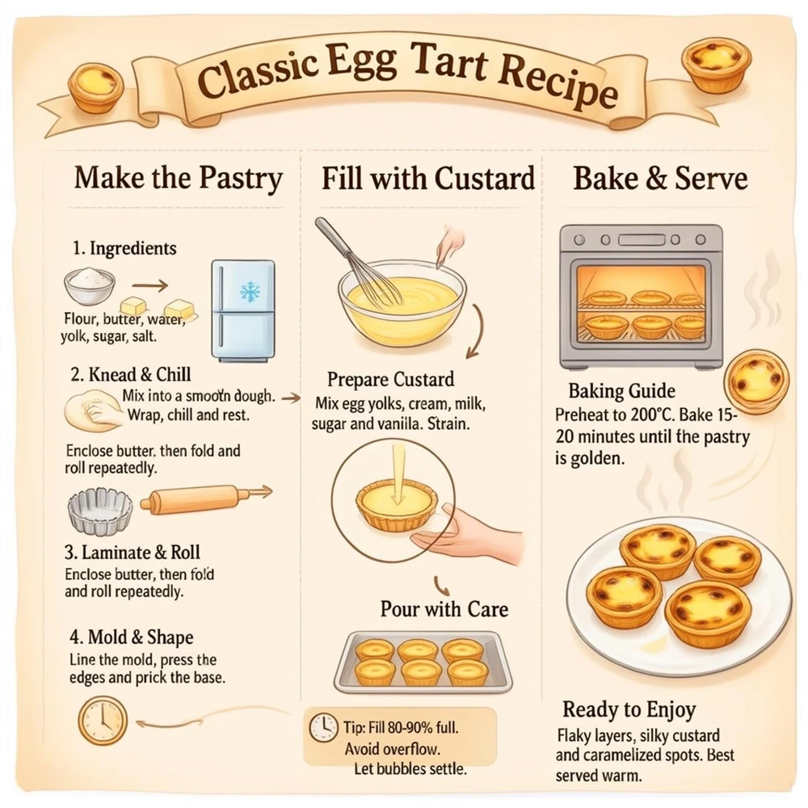
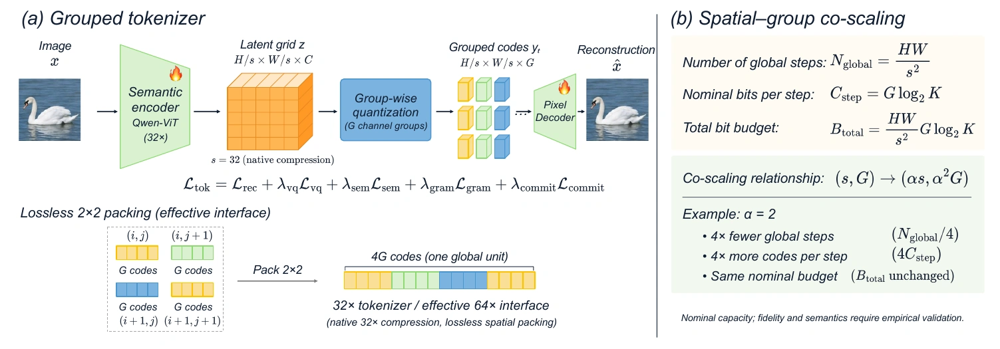
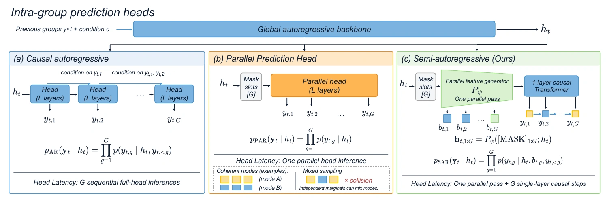
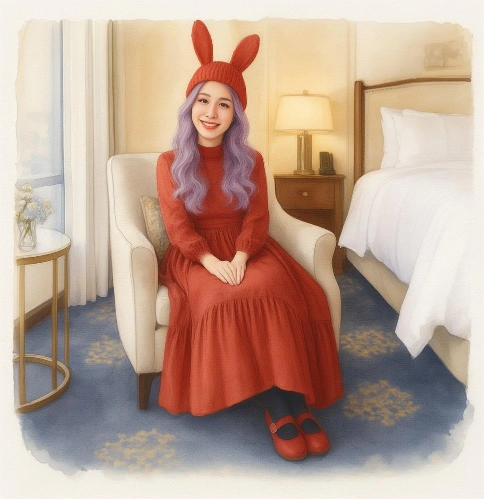
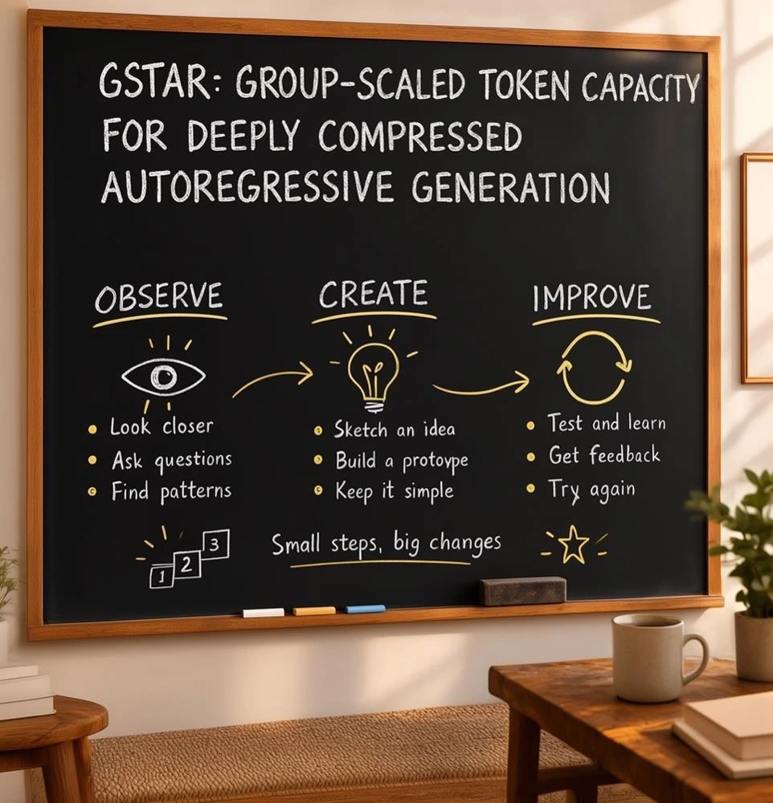

<div align="center">

# G-STAR: Group-Scaled Token Capacity for Deeply Compressed Autoregressive Generation 🔥

Xu Huang<sup>1,2*</sup> · Ye Huang<sup>1*</sup> · Xiaotong Li<sup>2†‡</sup> · Zhengrong Yue<sup>2,3</sup> · Jialv Zou<sup>2,4</sup> · Minhao Jing<sup>2</sup><br>
Haodong Li<sup>2,5</sup> · Wenhao Yan<sup>2,6</sup> · Yaxin Luo<sup>2,7</sup> · Duomin Wang<sup>1</sup> · Daquan Zhou<sup>1‡</sup>

<sup>1</sup> Peking University &nbsp; <sup>2</sup> Meituan Longcat &nbsp; <sup>3</sup> Shanghai Jiao Tong University &nbsp; <sup>4</sup> Huazhong University of Science and Technology<br>
<sup>5</sup> The Chinese University of Hong Kong &nbsp; <sup>6</sup> Tsinghua University &nbsp; <sup>7</sup> MBZUAI

<sup>*</sup> Equal contribution &nbsp; <sup>†</sup> Project lead &nbsp; <sup>‡</sup> Corresponding author

[](https://arxiv.org/abs/2611.13004)
[](https://dagroup-pku.github.io/G-STAR/)
[](https://huggingface.co/DAGroup-PKU/G-star)
[](https://github.com/DAGroup-PKU/G-STAR)
[](docs/installation-and-usage.md#install)
[](docs/installation-and-usage.md#install)
[](LICENSE)

[Installation & Usage](docs/installation-and-usage.md) · [Results](#-results) · [Citation](#️-citation)

</div>

<p align="center">
  
  
  
  
  
  
</p>

**G-STAR** is a **spatial–group co-scaling** framework for discrete autoregressive image generation. Under a fixed nominal information budget, the group size of a product-quantized tokenizer should scale **quadratically** with the per-axis spatial compression factor. Following this principle, G-STAR reaches **32× and effective 64× compression** while preserving strong reconstruction, understanding and generation, and a **semi-autoregressive head** models the intra-group code dependencies cheaply. At 1024 × 1024, **G-STAR-Flash-1.7B generates an image in 2.5 s on a single NVIDIA H200**, and **G-STAR-Pro-8B** scores **0.84 on GenEval** and **7.45 on GEdit-Bench**.

`G-STAR-Pro-8B` = quality-oriented, 32× compression&nbsp;&nbsp;|&nbsp;&nbsp;`G-STAR-Flash-1.7B` = low-latency, effective 64× compression

## 🔥 News
- `[2026.11.04]` 🔥 We release the **inference and training code** of G-STAR: text-to-image generation, instruction-based image editing, pretraining and SFT!

## 📑 Todo List

- [x] Inference code for text-to-image generation and image editing
- [x] Training code (pretraining & SFT) with AR and DSpark image heads
- [x] Text-to-image checkpoint with its matching tokenizer and SR2x refiner on [Hugging Face](https://huggingface.co/DAGroup-PKU/G-star)
- [ ] Remaining checkpoints and their matching visual refiners on Hugging Face
- [x] arXiv paper
- [x] Project page
- [x] Demo video

## 🎥 Demo

https://github.com/user-attachments/assets/0cdddc48-5801-41e0-a78f-04449bf01043

<p align="center">58 s, captions burned in · <a href="docs/assets/demo.mp4">MP4</a> · <a href="docs/assets/demo.vtt">Transcript (VTT)</a></p>

## 💡 Overview

Long token sequences keep images faithful but make autoregressive decoding slow; aggressive spatial compression shortens the sequence but starves each token of capacity. G-STAR keeps the global sequence short and gives every position enough discrete codes to represent the image.

| Component | Role |
| :--- | :--- |
| **Spatial–group co-scaling** | When per-axis compression grows by α, grow the group size by α². The sequence gets α² shorter while the nominal bit budget stays constant. |
| **Lossless spatial packing** | Pack a 2 × 2 neighborhood of native 32× tokens into one global step. The effective 64× interface keeps every quantized code. |
| **Semi-autoregressive head** | Compute features for all group slots in one parallel pass, then sample them with a single-layer causal Transformer (`dspark` in the configs). |
| **Qwen3 backbone** | A Qwen3 LLM with an embedding bridge and the image head supports text-to-image generation, instruction-based editing and image understanding, trained with pretraining and SFT. |

<p align="center"></p>

> Grouped tokenization and spatial–group co-scaling. Effective 64× compression uses native 32× tokenization plus lossless spatial packing.

<p align="center"></p>

> A fully causal head repeats expensive computation for every code; a fully parallel head drops intra-group dependencies. The semi-AR head runs the heavy trunk once and keeps only a lightweight causal module sequential.

## 📈 Results

### Text-to-image generation

Higher is better for all five scores. **Bold** = G-STAR.

| Model | Compression | Params | GenEval | DPG | PRISM | LongText | Qwen-Image |
| :--- | :---: | :---: | :---: | :---: | :---: | :---: | :---: |
| GPT Image 1 | — | — | 0.84 | 85.15 | 8.07 | 0.956 | 54.07 |
| Seedream 3.0 | — | — | 0.84 | 88.27 | 7.62 | 0.896 | — |
| HiDream-I1-Full | 16× | 17B | 0.83 | 85.89 | 7.26 | 0.543 | 43.08 |
| FLUX.1 [dev] | 16× | 12B | 0.66 | 83.84 | 6.85 | 0.607 | 21.58 |
| BAGEL | 16× | 14B | 0.88 | 85.07 | 6.20 | 0.373 | 42.04 |
| Z-Image | 16× | 6B | 0.84 | 88.14 | 7.56 | 0.935 | 49.10 |
| Qwen-Image | 16× | 20B | 0.87 | 88.32 | 7.41 | 0.943 | 49.23 |
| OmniGen2 | 16× | 4B | 0.86 | 83.57 | 6.48 | 0.561 | 40.70 |
| SANA-1.5 | 32× | 4.8B | 0.81 | 84.70 | 6.51 | 0.050 | 35.14 |
| *Autoregressive* | | | | | | | |
| Janus-Pro-7B | 16× | 7B | 0.80 | 84.19 | 6.21 | 0.019 | 23.53 |
| GLM-Image | 16× | 16B | 0.72 | 84.78 | 7.32 | 0.952 | 48.19 |
| Emu3.5 | 16× | 34.1B | 0.86 | 88.26 | 7.52 | 0.976 | 49.89 |
| BitDance | 16× | 14B | 0.86 | 88.28 | 7.19 | 0.837 | 45.19 |
| **G-STAR-Pro-8B** | **32×** | **8B** | **0.84** | **83.38** | **6.98** | **0.935** | **50.07** |
| **G-STAR-Flash-1.7B** | **64×\*** | **1.7B** | **0.76** | **80.18** | **6.81** | **0.853** | **46.88** |

> Compression is the per-axis spatial factor; \* Flash uses the packed effective 64× interface. PRISM: English combined score (0–10), Qwen2.5-VL-72B judge. LongText: English subset. Qwen-Image: Qwen-Image-Bench overall score (0–100). “—” means unreported.

### Low-latency generation

G-STAR-Flash-1.7B, 1024 × 1024, batch size 1, BF16, single NVIDIA H200. Each row adds to the one above.

| Pipeline | Latency | Speedup |
| :--- | :---: | :---: |
| Causal head baseline | 22.23 s | 1.0× |
| Semi-AR head | 14.93 s | 1.5× |
| + CUDA Graph | 5.85 s | 3.8× |
| + Kernel fusion | 3.37 s | 6.6× |
| **+ SGLang serving** | **2.50 s** | **8.9×** |

> Median of three timed trials after three warm-up iterations.

### Prediction heads

Matched ablation: Qwen3-1.7B initialization, 32×, G = 16, 512².

| Head | GenEval | DPG | PRISM | Head latency ↓ |
| :--- | :---: | :---: | :---: | :---: |
| Causal AR | 0.8386 | 82.48 | 5.46 | 6.44 s |
| Parallel | 0.7800 | 79.98 | 4.72 | 1.77 s |
| **Semi-AR** | **0.8253** | **82.60** | **5.46** | **3.41 s** |

The semi-AR head stays close to the causal head in quality at about half its head latency, while the fully parallel head loses quality.

### Reconstruction, understanding and editing

- **Reconstruction.** On ImageNet 512², the 32× tokenizer reaches **25.12 dB PSNR**; the effective 64× variant reaches **23.90 dB**, close to Open-MAGVIT2 at 16× (23.98 dB).
- **Understanding.** The discrete f32g16 tokenizer averages **64.7** over eight understanding benchmarks, on par with continuous visual features (64.6).
- **Editing.** G-STAR-Pro-8B scores **7.45** overall on GEdit-Bench (English, full set).

| Original | Edited | Original | Edited |
| :---: | :---: | :---: | :---: |
|  |  |  |  |
| | *Watercolor illustration* | | *Replace the blackboard heading* |

All numbers are reported in the paper, which includes the full per-benchmark tables and ablations.

## ⚙️ Installation & Usage

```bash
git clone -b main --single-branch https://github.com/DAGroup-PKU/G-STAR.git
cd G-STAR
```

See the **[Installation & Usage guide](docs/installation-and-usage.md)** for dependencies, weights and complete commands. Run all commands from the repository root.

| Get started | Guide |
| :--- | :--- |
| Install dependencies | [Environment setup](docs/installation-and-usage.md#install) |
| Download a checkpoint and its matching visual refiner | [Weights](docs/installation-and-usage.md#download-the-weights) |
| Generate images from text | [Text-to-image](docs/installation-and-usage.md#generate-an-image) |
| Edit images with instructions | [Image editing](docs/installation-and-usage.md#edit-an-image) |
| Choose an image head | [AR / DSpark heads](docs/installation-and-usage.md#image-heads) |
| Build training data | [Records, descriptors & manifests](docs/installation-and-usage.md#data) |
| Pretrain and fine-tune | [Pretraining & SFT](docs/installation-and-usage.md#training) |
| Run the checks | [Tests](docs/installation-and-usage.md#tests) |

> 💡 **Tip:** We recommend enhancing your prompt with [Qwen-Image-2.1-PE](https://huggingface.co/Qwen/Qwen-Image-2.1-PE-T2I) first — just add `--prompt-enhance` to `gstar.infer` (see [Prompt enhancement](docs/installation-and-usage.md#prompt-enhancement)).

> Inference runs on a single CUDA GPU (verified on an 80 GB H100). Model weights are distributed separately: always pair each checkpoint with the visual refiner released with it, since g8 and g16 exports are incompatible.

## 🗂️ Repository Structure

```text
gstar/          Weight init, data pipeline, training, inference / editing and periodic evaluation
gstar/vendor/   Backbone modeling, image heads, multimodal processor and KV-cache generation
configs/        Pretrain / SFT recipes, image-head model configs, DeepSpeed and role configs
scripts/        torchrun launcher for single- and multi-node training
tools/          Data preparation and data-pipeline checks
tests/          Unit tests and a two-GPU distributed smoke test
docs/           Project page and the installation & usage guide
```

## 🙏 Acknowledgement

Our work builds on many excellent projects: [Qwen3](https://github.com/QwenLM/Qwen3), [Baichuan-Omni-1.5](https://github.com/baichuan-inc/Baichuan-Omni-1.5), [CosyVoice](https://github.com/FunAudioLLM/CosyVoice), [Matcha-TTS](https://github.com/shivammehta25/Matcha-TTS), [Transformers](https://github.com/huggingface/transformers), [DeepSpeed](https://github.com/deepspeedai/DeepSpeed), [FlashAttention](https://github.com/Dao-AILab/flash-attention) and [SGLang](https://github.com/sgl-project/sglang).

## ✏️ Citation

If you find G-STAR useful, please consider giving a ⭐ and citing:

```bibtex
@misc{huang2026gstargroupscaledtokencapacity,
      title={G-STAR: Group-Scaled Token Capacity for Deeply Compressed Autoregressive Generation},
      author={Xu Huang and Ye Huang and Xiaotong Li and Zhengrong Yue and Jialv Zou and Minhao Jing and Haodong Li and Wenhao Yan and Yaxin Luo and Duomin Wang and Daquan Zhou},
      year={2026},
      eprint={2611.13004},
      archivePrefix={arXiv},
      primaryClass={cs.CV},
      url={https://arxiv.org/abs/2611.13004},
}
```

## License

Original G-STAR code is released under the [MIT License](LICENSE). Third-party components retain their respective licenses and copyright notices. Model weights and datasets are subject to their own terms.
